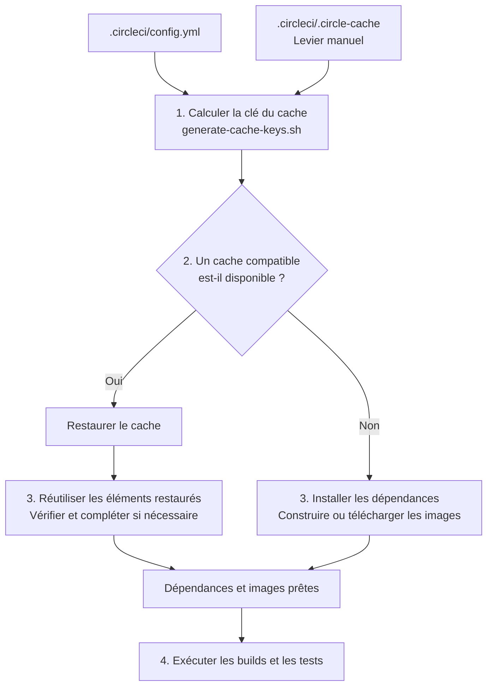

# ADR 001 - Continuous Integration

## Intégration Continue (CI)

### Contexte

Dans le projet nous utilisons actuellement CircleCI afin de jouer tous les checks et tests e2e, api, etc.

La CI du projet rencontre plusieurs problématiques :
- **Temps d'exécution élevé** : environ 1h par run en janvier 2026
- **Coûts importants** : factures CircleCI oscillant entre 900€ et 2000€/mois (objectif : 700€/mois)
- **Impact sur la DX** : ralentissement du travail des développeuses et développeurs

### Décisions et bonnes pratiques

#### 1. Arrêt automatique de la CI en cas d'échec précoce

**Décision** : Si l'un des jobs `lint-js`, `unit-js`, `unit-php` ou `typecheck-js` échoue, la CI s'arrête immédiatement.

**Raison** : Ces jobs sont rapides et détectent des erreurs fondamentales. Inutile de continuer les jobs lourds (e2e, build) si le code de base ne passe pas les vérifications essentielles qui vont de toute façon nécessiter un commit correctif, et donc une nouvelle CI.

#### 2. Découpage des tests Cypress

Les workflows `tests`, `test-and-build` et `preprod` exécutent six suites Cypress par fonctionnalité. Les specs front-office, back-office et de parcours de participation d’un même domaine peuvent ainsi être rejouées ensemble.

| Job | Exécuteurs |
| --- | ---: |
| `cypress-proposals` | 3 |
| `cypress-questionnaires` | 1 |
| `cypress-consultations-debates` | 3 |
| `cypress-accounts-access` | 2 |
| `cypress-projects-navigation` | 2 |
| `cypress-site-content` | 3 |

Les 14 exécuteurs remplacent les 20 du découpage par dossier. Chaque machine démarre sa propre stack Docker et restaure les données de test. CircleCI répartit les specs de chaque suite selon leurs durées historiques.

`prepare-test-data` construit une seule fois le cache Symfony `test` sans debug
dans le conteneur applicatif. Chaque machine le restaure avec les données de test
et réinitialise les flags Redis avec le helper commun aux tests.

Les exécuteurs PHP et le conteneur applicatif de CI définissent `APP_DEBUG=0` :
les commandes CLI et les kernels PHPUnit utilisent le mode sans debug, comme
les requêtes HTTP de test. Le cache reste propre au workflow et à sa révision.
Le debug reste disponible explicitement pour un test qui en dépend.

`prepare-admin-next` construit Admin Next en environnement `test` une seule fois,
en parallèle des données de test. Les machines Cypress récupèrent le même build
par le workspace, vérifient sa révision et démarrent uniquement le serveur.
Les autres suites ne dépendent pas de ce build. Ces préparations partagées sont
systématiques dans les workflows de tests ; leurs commandes et leur diagnostic
sont décrits dans [`docs/agents/circleci.md`](../docs/agents/circleci.md).

#### 3. Parallélisme optimisé

**Décision** : Le parallélisme est configuré à divers endroits pour diminuer le temps nécessaire à certains jobs très longs lors du run initial ou de potentiel rerun (si flaky ou échec circonstanciel).

Le découpage peut toujours être optimisé selon le quota de parallélisme disponible (ne pas dépasser le parallélisme maximum sous peine de facturation supplémentaire)

**Raison** : Réduit le temps total d'exécution en exploitant le test splitting.

Le job `unit-js` utilise 5 exécuteurs. Les tests historiques de `frontend/` sont répartis par CircleCI et les tests `admin-next` utilisent le sharding natif de Jest à partir de `CIRCLE_NODE_INDEX` et `CIRCLE_NODE_TOTAL`. Toute nouvelle suite ajoutée à ce job doit également être répartie, ou être explicitement limitée à un seul exécuteur, afin de ne pas être exécutée 5 fois.

Le job `phpunit-tests` utilise quatre exécuteurs. CircleCI découvre les fichiers `tests/**/*Test.php` et les répartit selon les durées historiques par fichier (`--split-by=timings --timings-type=file`). `MigrationCommandTest.php` reste exclu de cette sélection et exécuté par le job `migrations`. Les chemins transmis au répartiteur sont préfixés par `/var/www/` pour correspondre aux attributs `file` des rapports PHPUnit produits dans le conteneur. Un exécuteur sans fichier sélectionné s'arrête avant de préparer sa stack.

Chaque exécuteur transmet sa sélection à `php scripts/qa/phpunit.php` dans le conteneur applicatif avec `--tests`. Pour une sélection explicite, ce script construit une configuration PHPUnit temporaire dans le répertoire temporaire du conteneur (avec les chemins rendus absolus), en conservant ses réglages et en remplaçant ses suites par les fichiers sélectionnés. Cette configuration est supprimée après l'exécution, y compris en cas d'échec. Passer plusieurs fichiers positionnels à PHPUnit 9 est interdit : seul le premier serait exécuté. Les suites `default` et `Unit Tests` restent disponibles pour les exécutions locales. Tout échec de test doit faire échouer le job ; chaque exécuteur publie son propre rapport JUnit non vide comme résultats de tests et comme artefact. Les attributs de fichiers des rapports permettent à CircleCI d'affiner les prochaines répartitions.

Ce parallélisme doit rester volontairement limité : chaque exécuteur démarre sa propre stack Docker et restaure les données de test. Ajouter des exécuteurs réduit le temps des tests, mais duplique ce coût de restauration, consomme davantage de crédits et occupe plus de capacité de parallélisme sans gain nécessairement proportionnel.

L'exécuteur PHPUnit numéro 0 lance ensuite `.circleci/test-phpunit.sh`
pour vérifier le runner PHPUnit avec des tests synthétiques : sélection de
plusieurs fichiers, propagation d'un échec, rapports JUnit et nettoyage de la
configuration temporaire. Cette vérification réutilise sa stack Docker et ses
rapports temporaires ne sont pas publiés dans les durées historiques CircleCI.
Les trois autres exécuteurs ne la répètent pas. La phase
`phpunit_runner_validation` en mesure le coût.

#### 4. Données de test communes aux exécuteurs

**Décision** : Le job `prepare-test-data` réinitialise MySQL et Elasticsearch une seule fois par workflow. Il transmet par le workspace CircleCI le dump MySQL, l'instantané Elasticsearch, le pipeline d'ingestion `geoip`, les médias créés par les fixtures et le cache Symfony `test` sans debug, avec ses proxies Doctrine générés dans le conteneur. Les jobs Cypress, GraphQL API et PHPUnit restaurent ces données et ce cache dans leur propre stack Docker. Les feature flags Redis sont réinitialisés dans chaque stack ; Cypress continue à restaurer les données avant chaque suite.

**Raison** : Éviter de rejouer les migrations, les fixtures et l'indexation dans chaque exécuteur tout en conservant leur isolation. Les données sont recréées à chaque workflow car certaines fixtures dépendent de la date. Un artefact manquant ou une restauration incomplète fait échouer le job.

Dans l'image de test, Elasticsearch utilise l'UID 1001 et partage le GID 1000 avec l'application (UID 1000) pour accéder au dépôt d'instantanés. L'image de développement conserve l'UID Elasticsearch par défaut.

Les médias des fixtures restent possédés par l'application (UID 1000) et sont accessibles en écriture au groupe de l'exécuteur CircleCI, afin que les tests GraphQL puissent créer leurs copies temporaires.

Les logs Cypress affichent `restore_db` et `restore_es` pour la durée totale de chaque tâche. Les lignes `CI_RESTORE_TIMING` détaillent l'import MySQL dans le conteneur et les appels Elasticsearch (en millisecondes). L'écart avec les durées totales comprend notamment le démarrage de Docker/PHP et les opérations du script hors de ces appels. Comparer ces durées sur le sous-job le plus lent avant de modifier la restauration.

Les lignes `CI_TIMING` complètent ces mesures pendant la préparation des jobs.
Elles indiquent le début et la fin d'une phase, le job (`job`), l'exécuteur
(`node`), l'heure UTC (`at`), la durée en millisecondes (`duration_ms`) et le code
de sortie (`exit_code`, présent à la fin). Les mesures vont sur la sortie
d'erreur, sans y recopier les arguments des commandes ni modifier leur sortie
standard ou leur code de retour. `.circleci/timing.sh` permet de chronométrer une
commande ; `.circleci/test-data.sh` l'utilise aussi pour distinguer les phases
successives, y compris la phase qui échoue.

La génération des données distingue le reset de la base, les deux dumps MySQL,
l'instantané Elasticsearch, l'export du pipeline et les permissions. La
restauration distingue l'attente de chaque service, la création de la base et des
indices de contrôle, les imports, les validations, le pipeline `geoip`, le
nettoyage du cache Symfony et les flags. Les images Docker, leur démarrage, les
queues RabbitMQ, l'installation Composer, les extensions PHP, Relay, les deux builds JavaScript, les
dépendances Cypress et l'attente d'admin-next sont également chronométrés.
`CI_BUILD_CACHE` indique si chaque build JavaScript a été exécuté ou si ses
fichiers étaient déjà disponibles après restauration des caches. Les durées
globales des étapes CircleCI restent la référence pour les transferts de caches
et de workspaces ; les sous-phases sont incluses dans ces durées et ne doivent
pas être additionnées à nouveau. Comparer le même job et le même exécuteur,
notamment celui qui détermine la fin du workflow. Ces logs ne changent ni le
parallélisme ni les clés de cache.

MySQL est restauré avec son schéma au démarrage de chaque exécuteur. Les resets
entre tests utilisent ensuite `var/db.restore.sql` : suppression des lignes et
réimport dans une transaction, puis restauration des compteurs `AUTO_INCREMENT`
du socle. Le schéma et les contraintes restent en place ; cette méthode suppose
que les scénarios ne modifient pas le schéma. Le test de migrations reste isolé
dans son job dédié. Les resets locaux conservent l'import complet historique.
Les deux fichiers SQL sont produits et transmis par `prepare-test-data` ; un
fichier manquant fait échouer le job sans repli silencieux sur une autre méthode.

Pour comparer les deux méthodes sur le dump local, exécuter
`docker exec -w /var/www capco_application_1 bash scripts/agents/benchmark-mysql-restore.sh`.
Ce script utilise une base temporaire, compare les dumps après chaque restauration
et vérifie les clés étrangères, les données binaires, les tables vides et les
compteurs d'identifiants. Ses durées locales ne prédisent pas les durées CircleCI.

#### Dépendances des tests API et Cypress

Les tests API GraphQL et Cypress attendent les images Docker, les données de test
et les contrôles de qualité et tests unitaires déclarés dans `require-e2e` et
`require-e2e-api`. Ils n'attendent pas `migrations` ni `phpunit-tests` : ces jobs
s'exécutent en parallèle, ne leur fournissent pas d'artefact et restent requis
pour que le workflow soit vert. Un échec d'une suite n'annule pas les autres
suites déjà lancées.

#### Disponibilité d'Admin Next avant Cypress

Avant tous les jobs Cypress (backoffice et frontoffice), la CI attend une réponse
HTTP 2xx ou 3xx d'Admin Next via le proxy `capco.test`. Le même serveur Next.js rend
aussi des pages front office (`/projects`, `/blog`, `/contact`, pages CMS…) que Symfony
délègue via une réponse 418 interceptée par nginx. Le service lance son build en
arrière-plan ; démarrer Docker ne garantit pas que Next.js écoute déjà sur son port,
et nginx renvoie alors un 502. La vérification
est limitée à cinq minutes et fait échouer la préparation si les erreurs réseau
ou 5xx persistent, plutôt que de les ignorer dans les scénarios navigateur.

#### 5. Vérification de la couverture des specs Cypress

Le job `check-cypress-spec-coverage` vérifie que chaque spec sous `cypress/e2e` appartient à une seule suite. La sélection des jobs Cypress utilise la même liste de dossiers et de fichiers dans `.circleci/cypress-suites.cjs`. Les fichiers ajoutés dans un dossier déjà attribué héritent de sa suite. Pour un nouveau dossier ou une spec d’un dossier partagé entre plusieurs suites, ajouter son chemin à la suite concernée.

Depuis la racine du dépôt, exécuter `node .circleci/cypress-suites.cjs` pour vérifier la couverture, ou `node .circleci/cypress-suites.cjs proposals` pour afficher les fichiers du job `cypress-proposals`.

#### 6. Jobs non exécutés sur `master`

**Décision** : Certains jobs peuvent être désactivés sur `master` (ex: `typecheck-js`, `unit-js`, `unit-php`, `build-production-image`).

**Raison** : Si le code a été mergé via PR avec une CI verte, ces vérifications sont redondantes sur master.

#### Extensions PHP des exécuteurs CircleCI

Les jobs `prepare` et `unit-php` installent APCu 5.1.28 et Redis 6.1.0 avec
`.circleci/install-php-extensions.sh`. Le script utilise PIE 1.5.2, vérifie son
SHA-256 et active les deux modules avec `docker-php-ext-enable` dans les images
`cimg/php:8.1` et `cimg/php:8.1-node`. Ces versions sont alignées sur les images
applicatives. Ce chemin ne dépend plus de `install-php-extensions`, Pickle ni
des téléchargements PECL. L'installation échoue si les versions chargées ne
correspondent pas aux versions attendues.

#### Version de Node et Yarn

Tous les jobs exécutant JavaScript sur l'exécuteur CircleCI utilisent
`.circleci/setup-node.sh`. Ce script lit la version exacte de `.nvmrc`, réutilise
Node si la version correspond et installe sinon le binaire officiel après
vérification SHA-256. Le script écrit dans `BASH_ENV` un préfixe contenant les
répertoires de Node et des exécutables Corepack. À chaque chargement, ce préfixe
est ajouté au `PATH` courant : les chemins ajoutés par d'autres outils, notamment
`pyenv`, sont préservés. Enregistrer puis réappliquer une copie figée du `PATH`
pourrait rendre leurs commandes introuvables dans les shells suivants.
Corepack sélectionne la version de Yarn déclarée dans `package.json`.
Les conteneurs applicatifs conservent leur version Node fixée dans le Dockerfile ;
elle doit rester identique à `.nvmrc` lors d'une montée de version.

#### Images des exécuteurs machine

Les exécuteurs de tests et de builds QA/production utilisent le même tag daté
`ubuntu-2604:2026.07.1`. Ubuntu 26.04 LTS est supporté par CircleCI ; le tag
explicite évite qu'une mise à jour de `current` modifie Docker, Compose ou les
dépendances système sans validation. Le support et les nouveaux tags doivent
être revérifiés lors des mises à jour, selon la
[politique CircleCI](https://circleci.com/docs/guides/execute/linux-vm-support-policy/)
et le [catalogue Ubuntu 26.04](https://circleci.com/developer/machine/image/ubuntu-2604).

Les jobs conservent Docker et Compose fournis par l'image, la version Node de
`.nvmrc`, leurs classes de ressources et leur parallélisme. Les dépendances
Cypress utilisent les paquets Ubuntu 24.04 et ultérieurs (`libgtk-3-0t64`, `libasound2t64`).
Les stacks Docker et les préparations partagées restent propres à chaque
workflow.

Le profil manuel `validate-machine-images` exécute `prepare`, puis les deux jobs
de build existants avec `publish: false`. Il construit les images sans les
publier, modifier le dépôt `cluster`, déclencher Docker Scout, créer de release
Sentry ou déployer une instance. Les profils habituels conservent leur
comportement de publication. La procédure de validation et de comparaison est
décrite dans [le guide CircleCI](../docs/agents/circleci.md).

### Bonnes pratiques

#### Pour les développeuses

| Pratique | Description |
|----------|-------------|
| **Annuler les CI inutiles** | Annuler manuellement une CI en cours si on n'a pas besoin du résultat (travail non terminé, nouveau push imminent) |
| **Utiliser `[skip ci]`** | Ajouter `[skip ci]` dans le titre du commit pour éviter de déclencher une CI inutile |
| **Vérifier localement avant de push** | Lancer les linters et tests en local pour éviter d'utiliser des crédits inutilement |
| **Ne pas relancer toute la CI** | Utiliser le rerun des jobs individuels plutôt que relancer tout le workflow (nécessaire d'attendre la fin du workflow avant de rerun les tests échoués) |

#### Commandes utiles avant un push

```bash
# Linting
yarn lint
yarn prettier --check .

# Tests unitaires
yarn test
bin/phpunit tests/UnitTests

# TypeScript
yarn ts  # dans admin-next/
```

#### Gestion des tests flaky

Les tests flaky (tests qui peuvent échouer et passer sur le même commit) font échouer la CI sans raison liée aux modifications du code de la PR.

- Les tests flaky sont suivis dans l'issue [#17159](https://github.com/cap-collectif/platform/issues/17159)
- En cas de test flaky identifié, le créer comme sub-issue dans l'issue dédiée
- Prioriser la correction des tests flaky les plus fréquents

### Configuration CircleCI

#### Structure des workflows

```
prepare → prepare-docker → prepare-test-data → phpunit-tests / e2e-* / api-*

prepare → lint-js / unit-js / unit-php / typecheck-js / check-cypress-spec-coverage → (si succès) → e2e-* / api-* / build-*
```

Si l'un des jobs de vérification rapide échoue, les jobs suivants ne sont pas exécutés.

#### Cache

Le point d'entrée est [`.circleci/config.yml`](../.circleci/config.yml), qui appelle
[`.circleci/generate-cache-keys.sh`](../.circleci/generate-cache-keys.sh) pour calculer
les clés, puis les commandes de restauration et de préparation. Pour les dépendances
JavaScript et les images Docker de test, le parcours est le suivant :



Le cache évite de refaire les téléchargements, installations ou constructions déjà
effectués. S'il manque, les fichiers du dépôt permettent de recréer les éléments
nécessaires avant de lancer les builds ou les tests.

| Élément | Avec un cache utilisable | Sans cache |
| --- | --- | --- |
| Dépendances JavaScript | Yarn réutilise les paquets présents et complète si nécessaire. | Yarn télécharge et installe les dépendances. |
| Images Docker de test | Docker charge les images archivées. | Docker construit ou télécharge les images. |

Pour JavaScript, `yarn install --immutable` est exécuté dans les deux cas : la commande
reste la même, mais le travail dépend de ce qui est déjà présent. Pour Docker, charger
une archive utilisable évite de reconstruire l'image ou de la télécharger depuis le registre.

Le Docker Layer Caching (DLC) est désactivé sur `production-executor`, utilisé
pour construire les images QA et production. Sur le comparatif du 10 novembre
2026, à SHA, contexte et image de base identiques, le job
[avec DLC](https://circleci.com/gh/cap-collectif/platform/1756105) a consommé
224 crédits contre 58 pour le job
[sans DLC](https://circleci.com/gh/cap-collectif/platform/1756104).
La construction sans cache a pris 3 min 27 supplémentaires, mais économisé
166 crédits : le forfait DLC de 200 crédits par job dépassait le calcul évité.
Cette mesure justifie la désactivation ; le gain exact varie selon les builds.
Les caches de dépendances, de builds JavaScript et les archives Docker utilisées
par les machines de test restent indépendants de cette option.

Le cache CircleCI est limité (2GB inclus par période de facturation). Éviter de stocker des artefacts volumineux inutilement.
Afin de limiter les problèmes liés au cache et de diminuer les factures, nous avons choisi de diminuer la durée de conservation du cache.

Les caches utilisent des empreintes SHA-256 calculées par
`.circleci/generate-cache-keys.sh` à partir des chemins et contenus suivis par Git.
Les clés n'utilisent pas de compteurs de version propres à chaque famille. Le fichier global
`.circleci/.circle-cache` permet une invalidation manuelle et fait
partie de toutes les empreintes, en complément de l'invalidation automatique.
La configuration CircleCI et le générateur font partie de chaque empreinte : modifier
les exécuteurs, les commandes ou les chemins archivés invalide automatiquement les caches.
La valeur CircleCI `{{ arch }}` figure dans les clés hors Docker et archives de paquets
Yarn. Elle comprend l'OS, l'architecture, la famille et le modèle du processeur, comme décrit par
[le support CircleCI](https://circleci.zendesk.com/hc/en-us/articles/33215227752987-Different-Cache-Key-arch-within-Parallel-Runs-in-the-same-Job).
Pour les archives Docker de test, l'empreinte utilise seulement `uname -s` et
`uname -m` en plus des entrées de construction, sur les machines utilisant un
daemon local. À entrées identiques, deux machines Linux x86_64 partagent ainsi
leurs archives même si leurs modèles de processeur diffèrent ; une machine
Linux aarch64 utilise une autre clé. La clé Docker ne contient pas le nom de branche.
Le cache `~/.yarn/berry/cache` utilise l'empreinte des dépendances JavaScript et
le nom de branche, ce qui permet le partage des paquets entre modèles de processeur.

Les évolutions de sources ou de configuration sont prises en compte automatiquement.
Pour forcer un renouvellement global, notamment après un cache incorrect, modifier
la valeur de `.circleci/.circle-cache` avec une valeur inédite, commiter et pousser
le changement, puis lancer un pipeline sur cette révision. Toutes les familles
utilisent alors de nouvelles clés, y compris leurs clés de repli vers `preprod`.
Les anciennes archives ne sont pas supprimées : elles ne sont plus sélectionnées
par ces nouvelles clés. Une relance à entrées identiques conserve les mêmes clés.

| Famille | Entrées supplémentaires |
| --- | --- |
| Dépendances JavaScript | `.nvmrc`, scripts d'installation Node et JavaScript, `yarn.lock`, tous les `package.json` suivis, `.yarnrc.yml`, `.npmrc` et fichiers suivis de `.yarn/`. Les trois archives de `node_modules` et l'archive des paquets Yarn utilisent la même empreinte d'installation. |
| Builds frontend et Admin Next | Sources des deux applications, y compris les imports partagés et les utilitaires Admin Next, `packages/`, `scripts/`, `assets/`, `webpack/`, `public/`, **`src/Resources/`**, configuration TypeScript racine, Babel, Relay, schéma interne, script et contenu des traductions téléchargées. |
| Build Admin Next | En plus : `SYMFONY_GOOGLE_MAP_PUBLIC_KEY`, `SYMFONY_TURNSTILE_PUBLIC_KEY` et `NEXT_PUBLIC_SYMFONY_GOOGLE_MAP_PUBLIC_KEY`. L'environnement de compilation est fixé dans la commande CI. |
| Relay frontend | Entrées JavaScript communes et sources JS/JSX/TS/TSX/GraphQL suivies du dépôt, pour couvrir le périmètre du compilateur racine, notamment `admin-next/shared/` et les tests API. |
| Relay Admin Next | Entrées JavaScript communes, `admin-next/` et schéma interne. |
| Composer | `composer.json`, `composer.lock` et `symfony.lock` lorsqu'il existe. |
| Docker de test | Contextes `infrastructure/services/local/` et `infrastructure/services/elasticsearch/`, **les deux** fichiers Compose `base.yml` et `testing.yml`, helper `.circleci/docker-images.sh`, OS et architecture matérielle de la machine. |
| Rector | Entrées Composer, `rector.php` et fichiers `.php` suivis dans `src/`, `tests/`, `spec/`, `.castor/` et `scripts/qa/`. |

Les empreintes sont écrites dans `.circleci/cache-keys/*.sha256`, ignorées par Git.
Les jobs calculent leurs empreintes de dépendances avant restauration. `prepare` calcule
les empreintes de build après téléchargement des traductions, avant restauration des
artefacts ; `prepare-static` calcule seulement les empreintes Relay, sans dépendre des
traductions. Chaque famille conserve la même clé jusqu'à la sauvegarde : les fichiers
générés non suivis ne participent pas au calcul.

La couverture des sources est volontairement conservatrice : certains changements de
tests ou de configuration invalident davantage de caches que strictement nécessaire.
Toute réduction de ce périmètre doit préserver les imports croisés et être vérifiée par
les tests d'invalidation. Ajouter une entrée de compilation, un workspace ou une variable
publique doit conduire à vérifier le générateur et ses tests ; le levier manuel ne
doit pas masquer une entrée manquante dans la couverture automatique.

Le partage reste inchangé : restauration sur la branche courante, puis sur `preprod`
avec la même empreinte. Docker utilise une clé sans branche. Un cache est immuable ; la
migration des clés provoque un premier passage à cache froid, les anciennes archives
expirant selon la rétention CircleCI. Les empreintes ne consultent pas les registres :
un tag Docker distant mutable inchangé n'est pas renouvelé automatiquement. Changer la
référence d'image, idéalement son digest, fait partie de sa mise à jour. Un cache corrompu
reste un incident distinct de l'invalidation des entrées.

`node --test .circleci/cache-keys.test.cjs` vérifie le générateur dans des dépôts Git
temporaires, sans installer de dépendances ni lancer de build. Ce test est aussi exécuté
par `check-cypress-spec-coverage`. Le [guide CircleCI](../docs/agents/circleci.md)
décrit les phases du générateur et leur diagnostic.

Les caches de dépendances JavaScript sont facultatifs. Après les tentatives de
restauration, `prepare`, `prepare-static`, `typecheck-js`, `lint-js`, `unit-js`,
`prepare-admin-next` et la commande API/Cypress `start-e2e-container` exécutent
`ensure-js-dependencies`. Cette commande restaure l'archive des paquets Yarn puis
lance `yarn install --immutable` à la racine via `.circleci/install-js-dependencies.sh`,
même si les répertoires `node_modules` sont présents. Yarn réconcilie tous les workspaces
même si une seule archive a été restaurée et conserve le lockfile. Node et Corepack sont
préparés avant cette installation, et les machines E2E installent avant de démarrer
les conteneurs qui utilisent les dépendances. Une erreur d'installation arrête le job.
`prepare` et `prepare-static` sauvegardent les archives Yarn. Le job `migrations`
désactive la préparation JavaScript de `start-e2e-container` avec `prepare-js: false`.
La phase `CI_TIMING js_dependencies_install` permet de mesurer aussi le coût à cache chaud.

Le test `node --test .circleci/install-js-dependencies.test.cjs`, exécuté par
`check-cypress-spec-coverage`, utilise le vrai Yarn épinglé avec des paquets locaux
dans des workspaces temporaires. Il couvre les caches présents, absents et partiels,
ainsi que le refus de modifier le lockfile.

Les archives des images Docker de test sont également facultatives. Le helper
`.circleci/docker-images.sh prepare` construit ou télécharge chaque image dont
l'archive `images/<service>.tar` manque ou est vide, puis la sauvegarde atomiquement.
Un producteur à cache chaud réutilise ses archives sans les charger. Chez chaque
consommateur, le mode `load` vérifie le chargement et la présence du tag attendu ;
une archive absente, vide ou inutilisable déclenche la construction ou le téléchargement
du seul service concerné, selon les fichiers Compose. Les certificats sont préparés
avant ce chargement car ils font partie du contexte de construction applicatif.
Une erreur de construction, de téléchargement ou de sauvegarde arrête le job.
Les consommateurs ne sauvegardent pas leurs images réparées dans le cache CircleCI.

Ce repli reconstruit la recette courante ; avec des tags ou paquets amont mutables,
il ne garantit pas une image identique octet pour octet à celle du producteur.
Une archive corrompue reste immuable côté CircleCI, même lorsque le consommateur
la contourne. Le test `.circleci/docker-images.test.cjs` couvre les restaurations
et les erreurs avec un CLI Docker simulé ; les phases `CI_TIMING docker_*` et les
lignes `CI_DOCKER_CACHE` distinguent chargements et reconstructions réels en CI.

`prepare` génère les fichiers Relay seulement en l'absence d'artefacts restaurés depuis le
cache, puis les transmet aux jobs de lint, de vérification TypeScript et de tests Jest par le
workspace. Ces jobs ne relancent pas le compilateur Relay.

Le workspace de `prepare` transmet `admin-next/node_modules`, les dépendances PHP,
les fichiers générés et les assets consommés en aval. Les `node_modules` racine et
Cypress viennent des caches facultatifs ou de `ensure-js-dependencies` chez les
consommateurs JavaScript concernés. Pour Next.js, il transmet seulement `standalone`,
`static` et `types` ; le cache du compilateur reste dans les caches de build.
Il ne transmet pas `var` : les données et le cache Symfony `test` compilé sous
`/var/www` viennent de `prepare-test-data`. `prepare-docker` conserve sa dépendance
à `prepare`, mais n’attache pas son workspace car ses contextes Docker proviennent
du checkout. L’inventaire des consommateurs et le comparatif sont documentés dans
[`docs/ci-prepare-workspace.md`](../docs/ci-prepare-workspace.md).

#### Workflow QA à la demande

Le workflow QA est déclenché à la demande lorsqu'une pull request reçoit le label `🔬 In test`.
L'action GitHub transmet les paramètres `run_qa=true` et le numéro de la pull request à
CircleCI, qui exécute alors uniquement `prepare` puis `build-qa-image`. Le workflow
standard n'est pas exécuté dans ce cas.

Le workflow QA est filtré sur les branches de pull request et ne peut pas être exécuté sur
`preprod` ou `master`, afin de ne pas activer les étapes de déploiement incluses dans le job
`build-production-image`.

`build-qa-image` construit et pousse la même image applicative que le job de production, puis
met à jour l'instance QA dans le dépôt `cluster`. Il ne contient pas les étapes de déploiement
preprod/production ni la création de release Sentry. Les étapes communes de construction et de
publication sont factorisées entre les deux jobs.

`build-production-image` est exécuté par le workflow automatique de `preprod` et par le workflow
`deploy` de `master`, car ce job porte encore les étapes de déploiement correspondantes. Il
n'est pas exécuté automatiquement pour chaque branche de pull request.

`prepare` est conservé dans le workflow QA pour le moment : l'image Docker de production
consomme notamment les artefacts générés par les builds JavaScript et `admin-next`. La création
d'un `prepare-production` plus léger pourra être envisagée séparément après mesure des artefacts
réellement nécessaires.

Le secret GitHub `CIRCLECI_TOKEN` doit être configuré pour permettre à l'action de déclencher
CircleCI.

#### Workflows CI déclenchés par labels

Le workflow `test-and-build` n'est plus exécuté automatiquement pour les pushes de branches de
pull request. Les pipelines CircleCI déclenchés par le dépôt n'exécutent par défaut aucun profil
de tests. Le workflow GitHub `Trigger CircleCI workflows` déclenche les workflows correspondant
aux labels présents sur une pull request du même repository :

- `static` : analyse PHP, linters, vérification TypeScript, vérification GraphQL et couverture
  des spécifications Cypress ;
- `tests` : tests PHP, Jest, PHPUnit, migrations, GraphQL et Cypress, sans les contrôles statiques ;
- `full` : workflow complet `test-and-build`.
- `build-prod` : préparation puis construction de l’image via `build-production-image`, sans
  exécuter les autres jobs de validation ; ce profil est disponible pour les branches de pull request.
- `🔬 In test` : workflow `qa`, qui construit et déploie l’image sur l’instance QA.

La sélection applique les règles suivantes :

- `Workflow full` remplace `Workflow static` et `Workflow tests` lorsqu'ils sont présents
  ensemble ; les labels restent en place. Sans `full`, `static` et `tests` peuvent coexister.
  `build-prod` et `qa` restent indépendants ;
- un résultat est réutilisable pour la même branche, le même SHA complet, le même workflow et
  les mêmes paramètres de pipeline, numéro de PR QA compris. Une exécution active est conservée,
  et un dernier résultat réussi évite une nouvelle exécution. Un ancien succès ne masque pas
  une tentative plus récente échouée ou annulée ;
- un nouveau SHA, notamment après un rebase suivi d'un push, annule les workflows gérés encore
  actifs sur les anciennes révisions et lance les profils demandés sur la nouvelle révision.
  Un événement répété sur le même SHA ne relance pas ces profils ;
- ajouter un label lance seulement les profils manquants. Une exécution échouée ou annulée peut
  repartir lorsque son profil devient nouvellement demandé ; un changement d'un autre label
  ne la relance pas. Rejouer le même événement ne relance pas l'échec produit par cet événement ;
- retirer un label annule seulement les workflows actifs qui cessent d'être demandés. Retirer
  `full` rend à nouveau applicables les éventuels labels `static` et `tests`, avec réutilisation
  de leurs résultats réussis sur le même SHA ;
- remettre `🔬 In test` demande un redéploiement de la QA, même sur le même SHA, pour réactiver
  une instance mise en pause. Rejouer cet événement réutilise la QA déjà lancée depuis l'ajout ;
- un `workflow_dispatch` force uniquement le profil choisi (`static`, `tests`, `full` ou
  `build-prod`), même s'il a déjà réussi, et remplace uniquement ses exécutions actives.

Les événements et demandes manuelles d'une même branche sont traités séquentiellement par la
file d'attente GitHub, y compris la mise en pause QA. Le déclencheur recharge les labels et le
SHA courants et vérifie qu'ils n'ont pas changé avant les mutations. Il attend qu'un pipeline
CircleCI en création expose ses workflows avant de décider de lancer un autre pipeline. Si des
doublons sont déjà actifs, il conserve le plus ancien et annule les autres. Les workflows de
`preprod`, `deploy` et les workflows non gérés ne sont pas annulés par ce mécanisme.

La réconciliation est implémentée dans `.circleci/trigger-ci-profiles.cjs`, appelée par le
point d'entrée shell existant, avec la version Node de `.nvmrc` et sans installation de
paquets. Le checkout de `pull_request_target` reste celui de la branche de base.
Les tests `node --test .circleci/trigger-ci-profiles.test.cjs` simulent les API GitHub et
CircleCI ; ils s'exécutent aussi dans `check-cypress-spec-coverage`.

L'ouverture ou la réouverture d'une pull request ne déclenche aucun workflow. Si aucun label géré
n'est présent, aucun workflow n'est lancé. Les événements de pull request sont limités aux PR du
même repository ; ils ne doivent pas exécuter du code provenant d'un repository fork.

Le workflow `test-and-build` se termine par le job `test-and-build-gate`, un job `no-op` qui
réussit uniquement lorsque tous les jobs de validation du workflow ont réussi. Ce job doit être
configuré comme check obligatoire sur les pull requests vers `preprod` afin d'imposer l'exécution
manuelle du profil `full` avant le merge.

Le profil est transmis à CircleCI via le paramètre enum `ci_profile`. La valeur `none` est utilisée
pour les pipelines déclenchés automatiquement par le dépôt et n'exécute aucun profil de tests
sur les branches de pull request.

Sur `preprod`, la valeur `none` déclenche le workflow complet de validation et de construction,
qui comprend notamment `build-production-image`. Sur `master`, le workflow automatique `deploy`
reste limité à `prepare` et `build-production-image`. Le workflow QA reste indépendant des
profils `static`, `tests`, `full` et `build-prod`, mais il est recalculé par le même mécanisme
de labels et de synchronisation lorsqu'il porte le label `🔬 In test`.

La mise en pause de l'instance QA est exécutée dans `Trigger CircleCI workflows`, après
l'annulation réussie du workflow `qa` lors du retrait de `🔬 In test`, afin d'éviter une course
entre CircleCI et la mise à jour du dépôt `cluster`. La pause n'est autorisée que si le label
reste absent de l'état courant de la PR.

Les lectures et annulations de workflows CircleCI sont réessayées en cas d'erreur transitoire.
Si une lecture ou une annulation échoue encore après les tentatives prévues, aucun nouveau workflow
n'est déclenché et le job GitHub échoue afin d'éviter une exécution concurrente non maîtrisée.
La création d'un pipeline n'est pas réessayée automatiquement après une réponse ambiguë :
la réconciliation suivante recherche d'abord le pipeline éventuellement créé. L'API v2 résout
la branche au moment du déclenchement ; si le SHA obtenu diffère du SHA demandé, les workflows
actifs de ce pipeline sont annulés et le déclencheur échoue.

### Statut

Validé

### Références

- [CircleCI - Automatic reruns](https://circleci.com/docs/guides/orchestrate/automatic-reruns/)
- Issue flaky tests : [#17159](https://github.com/cap-collectif/platform/issues/17159)
- PR découpage Cypress : [#18869](https://github.com/cap-collectif/platform/issues/18869)
- PR arrêt CI sur échec : [#18873](https://github.com/cap-collectif/platform/issues/18873)
